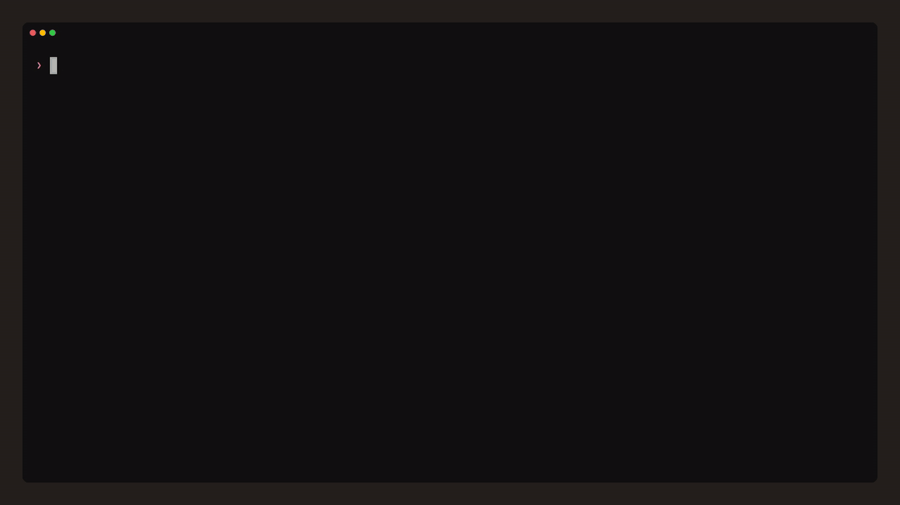

<div align="center">
  
  <h1>SQLito</h1>
  <p><strong>A keyboard-first SQLite client for the terminal.</strong></p>
  <p>SQL is the protagonist. The UI is a header, a results table and a prompt.</p>
  <p>
    <a href="https://www.npmjs.com/package/@pablo-v/sqlito"></a>
    <a href="https://github.com/PabloViniegra/sqlito/blob/main/LICENSE"></a>
    
    
    
  </p>
  <p>
    <a href="#installation">Install</a> ·
    <a href="#usage">Usage</a> ·
    <a href="#architecture">Architecture</a> ·
    <a href="CONTRIBUTING.md">Contribute</a>
  </p>
  <br />
  
</div>

---

## Table of contents

- [Overview](#overview)
- [Features](#features)
- [Installation](#installation)
- [Quick start](#quick-start)
- [Usage](#usage)
  - [Keyboard shortcuts](#keyboard-shortcuts)
  - [Dot-commands](#dot-commands)
- [Architecture](#architecture)
- [Project layout](#project-layout)
- [Development](#development)
- [Testing](#testing)
- [Roadmap](#roadmap)
- [Contributing](#contributing)
- [License](#license)
- [Graphify — AI knowledge graph](#graphify--ai-knowledge-graph)

## Overview

SQLito is a terminal client for SQLite, inspired by Claude Code. It is
built to be fast, clean and entirely keyboard-driven for browsing,
querying and editing local SQLite files. The surrounding chrome exists
only to keep you in flow.

```bash
sqlito <database.db>
sqlito --readonly <database.db>   # refuse every write
```

Everything else — autocompletion, history, CSV export, schema inspection —
is a layer on top of that one command.

## Features

|                              |                                                                                                  |
| ---------------------------- | ------------------------------------------------------------------------------------------------ |
| **Never blocks**             | Queries run in a background process, so a long one never freezes the UI and `Ctrl+C` cancels it. |
| **Clear outcomes**           | Every result carries a colored tag: READ, WRITE, DDL, ERROR or PLAN.                             |
| **Autocomplete**             | `Tab` completes table and column names from the live schema.                                     |
| **History**                  | Persistent per database, with Up / Down recall and `Ctrl+R` reverse search.                      |
| **Command palette**          | `Ctrl+P` surfaces every dot-command.                                                             |
| **Query plans**              | `.explain` re-runs the last query as `EXPLAIN QUERY PLAN` and draws the tree.                    |
| **Export**                   | Current result to CSV, as a file (`.export`) or on the clipboard (`.copy`).                      |
| **Variables and favourites** | `.set` / `.vars` for `:name` placeholders; `.save` / `.run` for saved queries.                   |
| **Themes**                   | `.theme`, persisted to `~/.config/sqlito/config.json`.                                           |
| **Tidy terminal**            | Uses the alternate screen and restores your terminal on exit.                                    |
| **Fast start**               | Bundled cold start under 400 ms, enforced by `pnpm bench`.                                       |

Results render in a windowed, terminal-native table; past queries scroll
with PageUp / PageDown. Navigation is keyboard-only throughout.

## Installation

Requires Node.js 22 or later.

```bash
npm install -g @pablo-v/sqlito
```

Or run it once without installing:

```bash
npx @pablo-v/sqlito ./path/to.db
```

Either way, the command is `sqlito`:

```bash
sqlito --help
sqlito ./path/to.db
```

## Quick start

Requirements: Node.js 22 or later, pnpm 9 or later, and a C toolchain
able to build native modules (`better-sqlite3`).

```bash
git clone https://github.com/PabloViniegra/sqlito.git
cd sqlito
pnpm install
```

Create a sample database (optional):

```bash
pnpm db:seed
```

Run the TUI against any SQLite file:

```bash
pnpm dev -- ./fixtures/sample.db
```

The `dev` script uses `tsx` to execute `src/main.tsx` directly, so you get
HMR-style reloads on save without an extra bundling step.

## Usage

### Keyboard shortcuts

| Shortcut              | Action                                                                                              |
| --------------------- | --------------------------------------------------------------------------------------------------- |
| `Enter`               | Submit the current SQL statement.                                                                   |
| `Tab` / `Esc`         | Open / close the autocomplete popup for the current prefix.                                         |
| `↑` / `↓`             | Move the prompt cursor up/down across visual rows.                                                  |
| `↑` / `↓`             | At the first / last visual row, recall previous / next entry from history.                          |
| `←` / `→`             | Move the cursor one character.                                                                      |
| `Home` / `End`        | Move the cursor to the start / end of the prompt.                                                   |
| `Backspace`           | Delete the character before the cursor.                                                             |
| `Delete`              | Delete the character after the cursor.                                                              |
| `Alt+←` / `Alt+→`     | Skip to the previous / next word boundary.                                                          |
| `Ctrl+U`              | Kill from the cursor to the start of the prompt.                                                    |
| `Ctrl+K`              | Kill from the cursor to the end of the prompt.                                                      |
| `Ctrl+W`              | Kill the word before the cursor.                                                                    |
| `Ctrl+A` / `Ctrl+E`   | Move the cursor to the start / end (readline aliases).                                              |
| `Ctrl+L`              | Clear the screen and re-anchor the prompt.                                                          |
| `Ctrl+P`              | Open the command palette.                                                                           |
| `Ctrl+R`              | Open reverse-i-search over the history.                                                             |
| `Ctrl+C`              | Cancel the running query, or exit when idle.                                                        |
| Bracketed paste       | Multi-line paste (`ESC[200~ … ESC[201~`) inserts newlines into the prompt without triggering Enter. |
| `PageUp` / `PageDown` | Scroll the past-queries viewport.                                                                   |

### Dot-commands

| Command                 | Description                                                                 |
| ----------------------- | --------------------------------------------------------------------------- |
| `.tables`               | List every table in the database.                                           |
| `.schema [table]`       | Print CREATE statements for every table, or for `<table>` plus its indexes. |
| `.indexes`              | List every index in the database, with its table.                           |
| `.set <name> <val>`     | Define a session variable, usable as `:name` in SQL.                        |
| `.unset <name>`         | Remove a session variable.                                                  |
| `.vars`                 | List active session variables.                                              |
| `.explain`              | Re-run the last query with `EXPLAIN QUERY PLAN`.                            |
| `.save <name>`          | Save the last query as a favourite.                                         |
| `.favorites`            | List saved favourites.                                                      |
| `.run <name>`           | Load a favourite's SQL into the prompt.                                     |
| `.forget <name>`        | Delete a favourite.                                                         |
| `.theme <name>`         | Switch the active theme (`default`, `high-contrast`).                       |
| `.export <path>`        | Export the last result to a CSV file.                                       |
| `.copy`                 | Copy the last result to the clipboard as CSV.                               |
| `.help`                 | Show the command reference.                                                 |
| `.quit` (alias `.exit`) | Close the database and exit.                                                |

## Architecture

SQLito is built as **Screaming Architecture on top of Clean
Architecture**. The top-level folders name the domain, not the framework,
and the dependency rule is enforced by convention:

```
Presentation  →  Application  →  Domain  ←  Infrastructure
```

- **Domain** has no outward dependencies. It contains the entities
  (`Database`, `Table`, `Column`, `Index`, `QueryOutcome`, `PlanNode`,
  `HistoryEntry`, `Favorite`, `Theme`) and pure behaviour: read-only
  detection, side-effect classification, CSV rendering, query-plan
  building.
- **Application** holds use cases: `ExecuteQuery`, `ExportCsv`, `CopyCsv`,
  `DescribeTable`, `SchemaPrettyPrint`, `RunExplain`, `LoadHistory`,
  `SaveHistory`, `GetAutocompleteSuggestions`, `SaveFavorite`,
  `ListFavorites`, `RunFavorite`, `ForgetFavorite`, `LoadTheme`,
  `SwitchTheme`, `SessionVariables`.
- **Infrastructure** adapts the outside world to the domain:
  `WorkerDatabase` (child process), `BetterSqliteDatabase`,
  `SqliteSchemaRepository`, `XdgHistoryRepository`,
  `XdgFavoritesRepository`, `XdgThemeRepository`. Keyboard handling lives
  in the presentation layer instead (`App.tsx`, `promptKeymap.ts`,
  `readline.ts`).
- **Presentation** is the Ink / React TUI: `App`, `Header`, `Prompt`,
  `ResultsTable`, `CommandPalette`, `AutocompletePopup`, `StatusBar`.

Components follow the container-presentational pattern and must not
exceed 250 lines of code. Strict TypeScript is enforced: `verbatimModuleSyntax`,
`erasableSyntaxOnly`, `noUnusedLocals`, `noUnusedParameters`,
`noFallthroughCasesInSwitch`.

## Project layout

```
src/
├── application/
│   ├── commands/         # ExportCsv, CopyCsv, parseCommand, commandRegistry
│   ├── queries/          # ExecuteQuery, DescribeTable, SchemaPrettyPrint, RunExplain
│   ├── autocomplete/     # GetAutocompleteSuggestions
│   ├── history/          # LoadHistory, SaveHistory
│   ├── favorites/        # SaveFavorite, ListFavorites, RunFavorite, ForgetFavorite
│   ├── theme/            # LoadTheme, SwitchTheme
│   └── variables/        # SessionVariables
├── domain/
│   ├── database/         # Database
│   ├── schema/           # Table, Index, renderCsv, escapeCsvField
│   ├── sql/              # Column, QueryOutcome, PlanNode, isReadOnly
│   ├── history/          # HistoryEntry
│   ├── favorites/        # Favorite, FavoritesRepository
│   └── theme/            # Theme, ThemeRepository
├── infrastructure/
│   ├── sqlite/           # WorkerDatabase, BetterSqliteDatabase, SqliteSchemaRepository
│   └── filesystem/       # XdgHistoryRepository, XdgFavoritesRepository, XdgThemeRepository
├── presentation/
│   ├── app/              # App, dotCommand, readline, promptKeymap, pastQueriesViewport
│   ├── components/       # Header, Prompt, ResultsTable, CommandPalette, StatusBar, AutocompletePopup
│   └── hooks/            # usePromptInput, useViewportSize
├── shared/
│   └── utils/            # formatCell, measureColumn, wrapPrompt, formatPlanTree
├── cli.tsx               # Commander entry point
└── main.tsx              # process argv bootstrap
```

## Development

Common scripts, run from the project root:

| Command          | Description                                                 |
| ---------------- | ----------------------------------------------------------- |
| `pnpm dev`       | Start the Ink entry via `tsx watch src/main.tsx`.           |
| `pnpm build`     | Bundle the CLI with `tsup` into `dist/`.                    |
| `pnpm typecheck` | Type-check with `tsc -b`.                                   |
| `pnpm lint`      | Run oxlint with the project rules.                          |
| `pnpm test`      | Run Vitest in watch mode.                                   |
| `pnpm test:run`  | Run Vitest once (used by pre-commit).                       |
| `pnpm format`    | Format `src/**/*.{ts,tsx,json,md}` with Prettier.           |
| `pnpm db:seed`   | Generate the sample SQLite database in `fixtures/`.         |
| `pnpm bench`     | Measure cold start of the built CLI. Budget: 400 ms.        |
| `pnpm gate`      | Run `lint-staged` → `tsc -b` → `vitest run` → `pnpm bench`. |
| `pnpm doctor`    | Run `react-doctor` against the presentation layer.          |

A Husky pre-commit hook runs `lint-staged` (oxlint + Prettier on staged
files), then `tsc -b`, then `vitest run`. The hook is installed by
`pnpm prepare` and runs on every commit.

## Testing

The test split mirrors the architecture:

- **Unit tests** target the domain. They are pure, fast and free of I/O.
- **Integration tests** exercise use cases against an in-memory
  `better-sqlite3` database.
- **UI tests** are Ink snapshots that render components in a virtual
  frame (`presentation/components/renderInkFrame.ts`).

Run them locally with:

```bash
pnpm test:run
```

## Roadmap

Shipped:

- **v0.1** — CLI, SQL execution, results table.
- **v0.2** — Persistent history, autocompletion, CSV export.
- **v0.3** — Session variables (`.set`/`.unset`/`.vars`), `EXPLAIN QUERY
PLAN` view (`.explain`), favourite queries
  (`.save`/`.run`/`.forget`/`.favorites`).
- **v1.0** — Command palette, themes (`.theme`), persistent config file.
- **v1.1** — Fluid terminal UX: alternate-screen buffer, viewport-aware
  prompt, readline-style editing (kill / word-skip / multi-line wrap),
  history recall at edit boundary, screen clear, scrollable past-query
  viewport (PageUp/PageDown), memoised frames, cold-start bench gate.

- **v1.2 – v1.3** — Diagnostics fixes and a cancellable worker process:
  queries run off the UI process and `Ctrl+C` stops them.

Planned:

- Plugins.

## Contributing

Contributions are welcome and go through a single, mandatory workflow:
**fork the repository and open a pull request**. Direct pushes are not
accepted under any circumstance.

Read [`CONTRIBUTING.md`](CONTRIBUTING.md) for the full process, the
quality gates every PR has to clear, the branching and commit
conventions, and the coding rules derived from
[`AGENTS.md`](AGENTS.md). The fork and pull request flow described there
is the only path for changes to land.

## License

SQLito is released under the [MIT License](LICENSE). Copyright (c) 2026
Pablo Viniegra.

<!-- graphify:start -->

## Graphify — AI knowledge graph

This project uses [Graphify](https://github.com/safishamsi/graphify) to
generate a queryable knowledge graph of the source code. AI coding
assistants read the graph instead of broad file searches, which reduces
unnecessary reads and improves accuracy.

The graph is built locally in `graphify-out/` (git-ignored) and
regenerates automatically after each commit.

### Setup (once per machine)

Requires Python 3.12+.

```bash
pip install graphifyy
python -m graphify .
```

> **Windows note:** always use `python -m graphify`, never `graphify`
> directly — the executable may not be on PATH.

### Manual update

```bash
python -m graphify . --update
```

### Query the graph from your assistant

```bash
python -m graphify query "where is the projects store?"
python -m graphify path "ModuleA" "ModuleB"
python -m graphify explain "concept-name"
```

<!-- graphify:end -->
